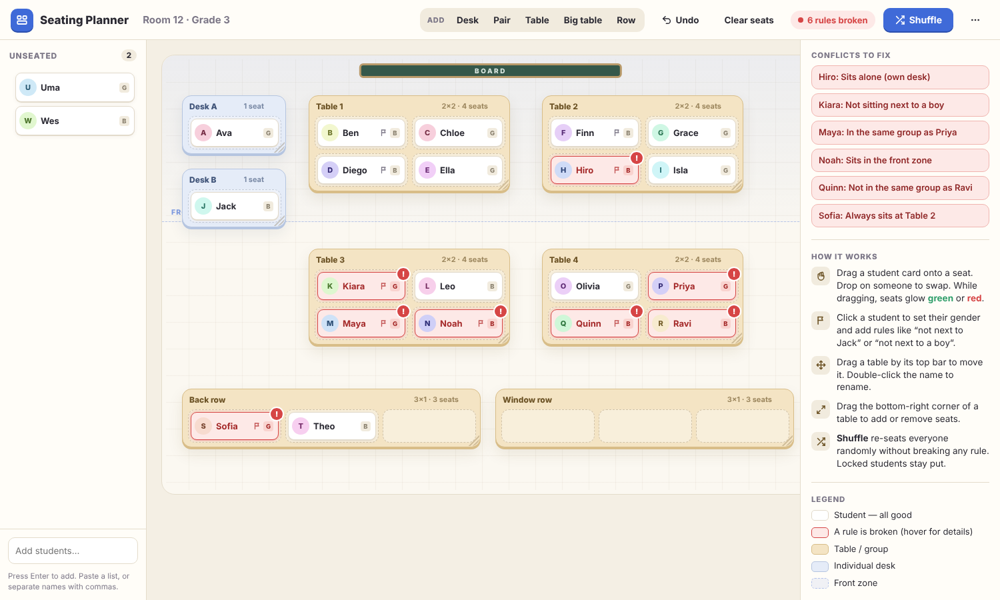

# Class Seating Planner

A single-file, no-install seating plan tool for elementary teachers. Open `index.html` in any browser.

## Features

- **Student cards**: drag them between seats, onto a classmate to swap, or back to the *Unseated* list. Works with mouse and touch.
- **Groups**: individual desks, pairs, tables and rows. Drag the top bar to move a group, drag the bottom-right corner to resize it (add/remove seats), double-click the name to rename it.
- **Rules per student** (click a card):
  - Not in the same group as *student*
  - Not sitting next to *student*
  - In the same group as *student*
  - Not sitting next to a *boy / girl*
  - Sits in the front zone (shaded band near the board)
  - Sits alone (own desk)
  - Always sits at *group*
- **Red cards**: any card whose rule is broken turns red (hover it to see why). While dragging, every seat glows green or red to preview the result of dropping there.
- **Shuffle**: re-seats everyone randomly while satisfying every rule (randomised backtracking search). Students marked *Keep in this seat* are not moved. If no valid arrangement exists, it finds the one with the fewest broken rules and highlights them.
- Undo (Ctrl/⌘+Z), automatic saving in the browser, download/load the plan as JSON, and print (via the ⋯ menu).

"Next to" means directly left, right, in front or behind within the same group (not diagonal).
